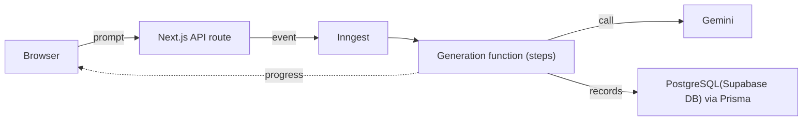

I/0 (Input/Output)

Describe a UI in plain language and get back a working React component. Preview it live in the browser, then download the code.

**[Live demo](https://i0-two.vercel.app)** · Next.js · TypeScript · Inngest · Prisma · Gemini

 [**Watch the Project Demo Video on Google Drive**](https://drive.google.com/file/d/1BVgxPGkYiJC5-MMRv-5sSXk2RUYcbrVu/view?usp=drive_link)
 
## What it does

- Turns a text prompt into a React component using Gemini.
- Shows the generated component in a live preview, then lets you download the code.
- Saves your projects. The Chats page lists them and has search.
- Has accounts: sign-in with NextAuth, profile editing, and password reset by email.

## How it works

The generation doesn't run inside the request that starts it. The API route sends an event to Inngest, and Inngest runs the generation in the background.



1. You submit a prompt. The route hands the work to Inngest as an event instead of generating inside the request.
2. Inngest runs the generation function in steps. Each step runs as its own invocation, so it stays inside Vercel's serverless time limit (10s on my deployment) and can retry on its own.
3. The model call goes to Gemini. If Gemini throttles the request, the step retries with exponential back-off. A concurrency limit caps how many generations run at once, so several users don't trip the provider's rate limits together.
4. The result is saved, records in PostgreSQL through Prisma.
5. Progress reaches the browser by subscribing to real-time changes using inngest Realtime as Prisma updates the records.

## Design decisions

**Background jobs instead of a long-lived request.** I first streamed results over Server-Sent Events. On a serverless platform that ties a generation to one request: it is bound by the function time limit, and a dropped connection or a slow model response can end it. Moving the work into Inngest steps separates the generation from the connection that started it.

**Retries and concurrency are configured, not assumed.** LLM providers rate-limit and fail intermittently. Back-off, retries and concurrency limits live in the Inngest function config, so a failed call is retried without redoing the steps that already finished.

**Account security.** Login uses NextAuth. Password reset sends an email through Nodemailer with a one-time token generated by Node's `crypto.randomBytes`.

**Gemini through the OpenAI Responses API.** The app talks to Gemini (Google AI Studio) using the OpenAI Responses API format.

## Tech stack

| Area | Tools |
| --- | --- |
| App | Next.js (App Router), React, TypeScript, Tailwind CSS |
| Live preview | Sandpack |
| Background jobs | Inngest |
| Database | Supabase DB, Prisma |
| Auth and email | NextAuth, Nodemailer |
| AI | Gemini (flash-lite) via Google AI Studio |
| Hosting | Vercel |

## Run it locally

1. Clone and install:

   ```bash
   git clone https://github.com/Genesispro-maker/I0.git
   cd I0
   npm install
   ```

2. Create a `.env` file in the project root:

   ```env
   DATABASE_URL="your-postgresql-url"
   SUPABASE_URL="your-supabase-url"
   SUPABASE_ANON_KEY="your-supabase-anon-key"
   OPENAI_API_KEY="your-openai-api-key"
   GEMINI_API_KEY="your-gemini-api-key"
   GITHUB_ACCESS_TOKEN="your-github-token"
   INNGEST_SIGNING_KEY="your-inngest-key"
   # Also add the variables your auth and email setup needs
   # (the NextAuth secret and URL, and the SMTP credentials for Nodemailer).
   ```

3. Run the database migrations:

   ```bash
   npx prisma migrate dev
   ```

4. Start the app and the Inngest dev server in two terminals:

   ```bash
   # Terminal 1: the Next.js app
   npm run dev

   # Terminal 2: the Inngest dev server
   npx inngest-cli@latest dev -u http://localhost:3000/api/inngest
   ```

5. Open [http://localhost:3000](http://localhost:3000).

## Status

A personal project, deployed on Vercel. The source is open, so feel free to read it or open an issue.
